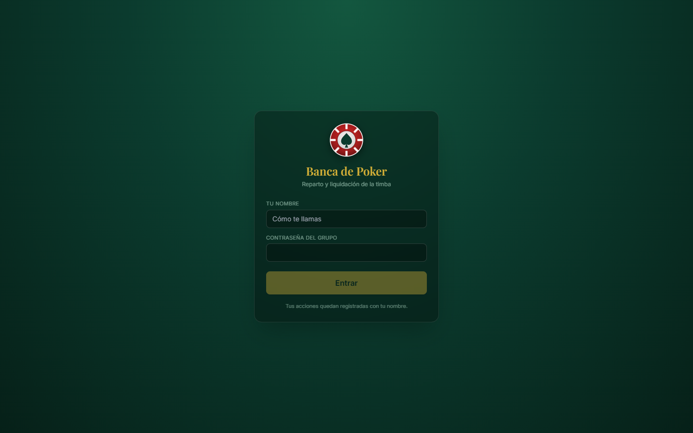

# Banca de Póker

Reparto de fichas y **liquidación de timbas de póker** entre amigos: quién debe cuánto a quién al acabar la partida.

**En vivo:** https://pokerlosreales.pages.dev (con contraseña del grupo)



## Qué hace

- **Preparar la partida:** jugadores, valor de cada color de ficha y *buy‑in*.
- **Durante la partida:** recompras por jugador y recuento de fichas al final.
- **Cuatro formas de liquidar** (`src/lib/chips.ts`):
  - **Mínimos pagos:** empareja deudores y acreedores para hacer el menor número de transferencias.
  - **Banca:** la banca tiene todo el dinero desde el principio y al cerrar paga a cada jugador el valor de sus fichas.
  - **Banca al cierre:** la banca solo aparece al final; los perdedores le pagan y ella paga a los ganadores.
  - **Cadena:** cada jugador hace como máximo dos pagos, uno entrante y otro saliente.
- **Historial y ranking** de partidas, contactos guardados y enlace para compartir el resultado.
- **Registro de auditoría:** cada acción queda guardada con el nombre de quien la hizo, y se pueden recuperar contactos o partidas borrados.

## Stack

| Parte | Tecnología |
|---|---|
| Frontend | React 19, TypeScript, Vite, Tailwind CSS, Zustand |
| API | Cloudflare Pages Functions (`functions/api/`: login, sesiones, contactos, auditoría, restaurar) |
| Datos | Cloudflare D1 (`schema.sql`) |
| Acceso | Contraseña de grupo y cookie de sesión firmada con HMAC‑SHA256 (`AUTH_PASSWORD` y `AUTH_SECRET` como secretos) |

## Desarrollo

```bash
npm install
npx wrangler d1 execute poker-banca --local --file=./schema.sql
npm run build && npx wrangler pages dev dist
```

Despliegue paso a paso en [DEPLOY.md](DEPLOY.md).

## Licencia

[MIT](LICENSE)
